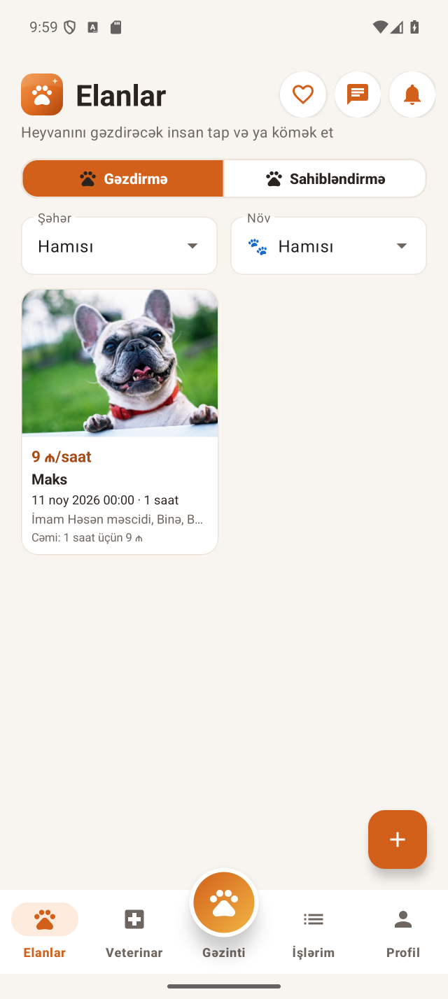
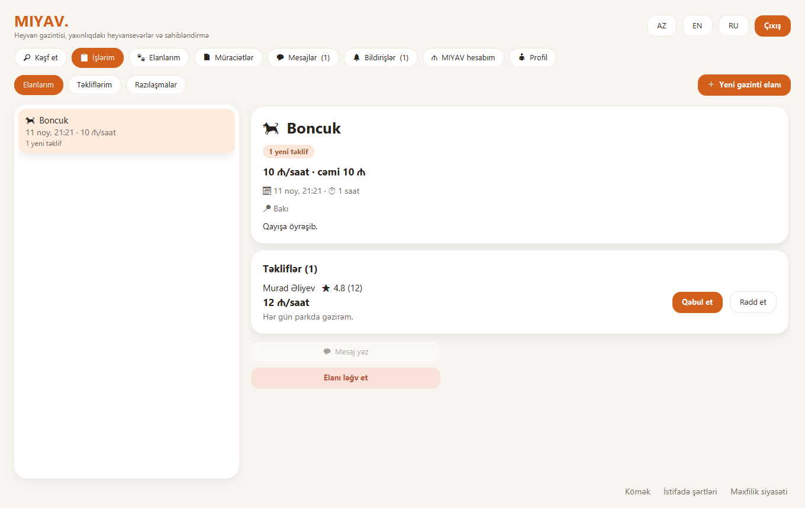
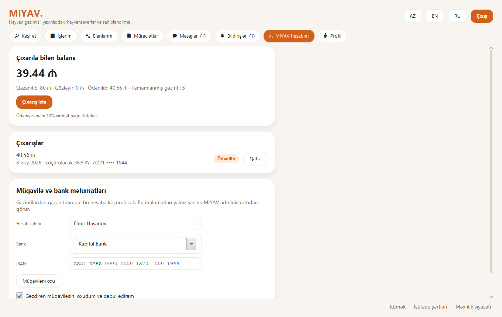
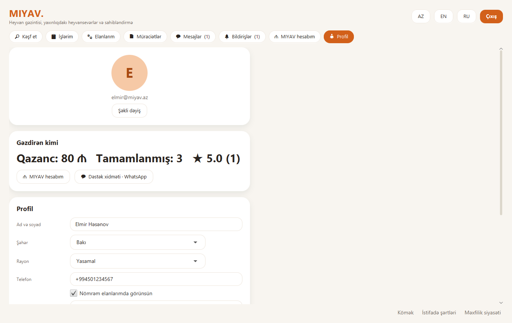
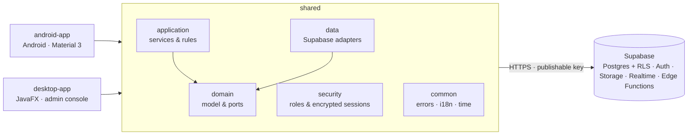

<div align="center">

# 🐾 MIYAV

**Pet walking, adoption and pet care for Azerbaijan: one Android app, one Windows desktop app, one shared Java core.**

*Heyvan gəzdirmə, sahibləndirmə və baytar xidmətləri: Android və Windows üçün.*

[](https://github.com/bysaint-d/Miyav/actions/workflows/foundation.yml)
[](https://github.com/bysaint-d/Miyav/releases/latest)


Azərbaycanca · English · Русский

</div>

<p align="center">
  
  &nbsp;
  
</p>

## Download

Get the latest build from **[Releases](https://github.com/bysaint-d/Miyav/releases/latest)**:

| Platform | File | Notes |
| --- | --- | --- |
| Android 8.0+ | `MIYAV-1.8.0.apk` | Allow "Install unknown apps" for your browser or file manager. Updates 1.7.0 in place. |
| Windows 10/11 (64-bit) | `MIYAV-Setup-1.8.0.exe` | Self-contained installer with its own Java runtime; nothing else to install. |

What changed in each version: [CHANGELOG.md](CHANGELOG.md).

## Features

**Pet walking**
- Owners post a walk request (pet, time, length, hourly price, area); walkers send offers or counter-offers.
- *İşlərim / My jobs*: requests with offers to answer, offers sent, agreed walks. Choose a walker, chat, cancel,
  mark the walk done.
- 1–5 star walker ratings with a short review; walkers' averages appear next to every offer.
- Live walk tracking with route history on Android.

**MIYAV wallet (walkers)**
- Earnings from completed walks build up a balance.
- Bank details (IBAN checked with mod-97) and acceptance of the walker agreement.
- Withdrawal requests. An administrator pays the net amount (10% service fee) and records the bank
  reference, and the walker gets a receipt. All amounts are computed on the server.

**Adoption and community**
- Adoption listings with photos, filters, favourites, applications and premium placement.
- Vets and pet shops on a map, chat with photos, push notifications in the reader's language.
- Guest mode: browse everything without an account; sign in only to act.

**Admin console (desktop)**
- Overview, users, listings, walks, places, reports, chat review with audit trail, broadcasts.
- Premium receipts and walker withdrawals queues.

<p align="center">
  
  
</p>

## Architecture



- Both clients share every business rule through `shared/application`, and the database enforces the same
  rules again with row level security and `security definer` functions in a private schema.
- Clients only ever hold the publishable key; the build refuses a secret key.
- Requests go through one pooled HTTP/2 client that is warmed up at start, and screens load independent
  data in parallel.

More detail: [docs/MIYAV_ARCHITECTURE.md](docs/MIYAV_ARCHITECTURE.md) · [docs/SECURITY.md](docs/SECURITY.md) ·
[docs/DATABASE_DESIGN.md](docs/DATABASE_DESIGN.md)

## Build from source

**Requirements:** JDK 21, Android SDK (platform 35), Windows for the installer
([Inno Setup 6](https://jrsoftware.org/isinfo.php) for `Setup.exe`).

1. Copy `local.properties.example` to `local.properties` and fill in `sdk.dir`, `supabase.url` and
   `supabase.publishableKey`. Never put a secret or `service_role` key there.
2. Build and test:

```bat
rem Tests and lint
gradlew.bat test :desktop-app:test :android-app:testDebugUnitTest :android-app:lintDebug

rem Debug APK in android-app\build\outputs\apk\debug\
gradlew.bat :android-app:assembleDebug

rem Run the desktop app
gradlew.bat :desktop-app:run
```

**Release builds**

```bat
rem Android: signing from keystore.properties (see keystore.properties.example) or MIYAV_UPLOAD_* variables
gradlew.bat :android-app:assembleRelease

rem Windows: self-contained app image, then the installer in desktop-app\build\installer\
gradlew.bat :desktop-app:packageAppImage
"%LOCALAPPDATA%\Programs\Inno Setup 6\ISCC.exe" desktop-app\packaging\miyav.iss
```

**Offline previews:** `gradlew.bat :desktop-app:memberPreview` and `:desktop-app:consolePreview` render every
desktop page from in-memory data and save PNGs under `desktop-app/build/`.

## Database

The live schema lives in [`supabase/migrations`](supabase/migrations), one additive migration per change, and
Edge Functions in [`supabase/functions`](supabase/functions) (`dispatch-push`, `delete-account`). Every table in
the exposed schema has RLS; privileged logic runs in `private.*` functions behind thin public wrappers.

## Project layout

```text
android-app/        Android client (Java, Material 3, view binding)
desktop-app/        JavaFX client and admin console; packaging/ holds the installer script and icon
shared/
  common/           errors, locale catalogs (az, en, ru), clock
  domain/           model, validation, repository interfaces
  application/      services shared by both clients
  security/         role guard, encrypted session store
  data/             Supabase REST, Auth, Storage and Realtime adapters
supabase/           migrations and Edge Functions
docs/               architecture, security, design system, guides, screenshots
config/             configuration templates
```

## Documentation

| Topic | Document |
| --- | --- |
| Architecture and OOP design | [MIYAV_ARCHITECTURE.md](docs/MIYAV_ARCHITECTURE.md), [OOP_DESIGN.md](docs/OOP_DESIGN.md) |
| Database and API contracts | [DATABASE_DESIGN.md](docs/DATABASE_DESIGN.md), [API_CONTRACTS.md](docs/API_CONTRACTS.md) |
| Security model | [SECURITY.md](docs/SECURITY.md) |
| Design system | [DESIGN_SYSTEM.md](docs/DESIGN_SYSTEM.md) |
| Android release and Google Play (az) | [ANDROID_PRODUCTION_GUIDE.md](docs/ANDROID_PRODUCTION_GUIDE.md) |
| Deployment | [DEPLOYMENT_GUIDE.md](docs/DEPLOYMENT_GUIDE.md) |
| Known limitations | [KNOWN_LIMITATIONS.md](docs/KNOWN_LIMITATIONS.md) |
| Tests and readiness | [TEST_REPORT.md](docs/TEST_REPORT.md), [PRODUCTION_READINESS_REPORT.md](docs/PRODUCTION_READINESS_REPORT.md) |

## Support

WhatsApp: [+994 50 347 73 06](https://wa.me/994503477306)
