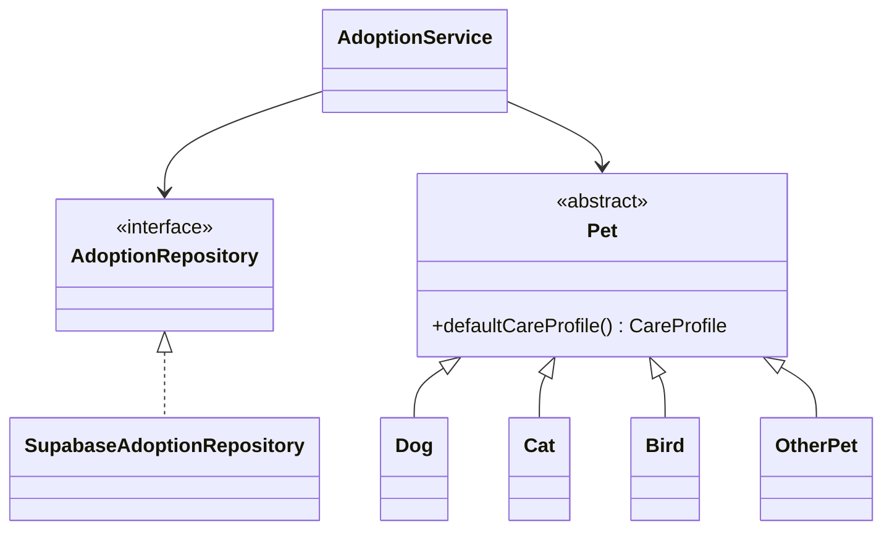
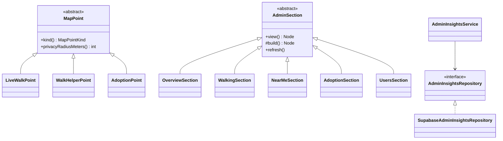

# OOP design

The shared Java core is the academic and production model. UI classes are adapters. Business rules live in constructors, validators, and services.

## Encapsulation

`User`, `Pet`, `AdoptionApplication`, `AuthSession`, and the other entities keep fields private. There are no setters. A change such as `withStatus` or `withProfile` returns a new instance, so a caller cannot mutate a stored application. `AuthSession.toString` omits tokens. `SupabaseConfig` does not expose a secret in its string form, and it refuses to be constructed from a service-role key.

Invalid pets cannot be constructed: name, city, description, age, and the published-photo rule are checked in the `Pet` constructor. Validators used by services repeat the checks that happen before a network call.

## Inheritance

`Pet` is abstract. `Dog`, `Cat`, `Bird`, and `OtherPet` extend it. The subclasses exist because the live schema allows four species, not only cats and dogs. `Bird` and `OtherPet` keep those rows representable. Each subclass passes its species to the protected constructor, so a `Dog` cannot be labeled as a cat.

## Polymorphism

`Pet.defaultCareProfile()` is abstract. Callers, including `PetService`, hold a `Pet` reference. `Dog` reports outdoor time. `Cat` reports litter care. The factory selects the class from `PetSpecies`, which is the value stored in `adoption_listings.species`.

Repository interfaces are the other polymorphic boundary. `AuthService` depends on `AuthRepository`. Tests supply Mockito doubles. The desktop and Android apps supply `SupabaseAuthRepository`. The service does not know which one it has.

## Abstraction

`AuthRepository`, `UserRepository`, `PetRepository`, `AdoptionRepository`, `MessageRepository`, and `NotificationRepository` are the ports. `TimeSource`, `MessageCatalog`, `SessionStore`, and `HttpTransport` are the other abstractions. `AdoptionRepository` has a Supabase implementation that fails closed, and the unit test uses an in-memory implementation that is not on the production classpath.

## SOLID

- Single responsibility: validators validate, services coordinate, repositories talk to HTTP, controllers render.
- Open/closed: a new species is a new `Pet` subclass plus a factory arm. Existing services stay unchanged.
- Liskov: every `Pet` subclass honors the same constructor invariants, including the published-photo rule.
- Interface segregation: message sending is not forced through the pet repository. Telegram is its own interface.
- Dependency inversion: `AdoptionService` receives `AdoptionRepository`, `PetValidator`, `RoleGuard`, and `TimeSource`. It does not construct OkHttp.

## Adoption rules in the service

`AdoptionService` rejects an application to the applicant's own listing, a listing that is not `PUBLISHED`, a second accept, a decision by someone who is not the owner, and a cancellation by someone who is not the applicant. Those rules are unit-tested. They are not a substitute for a database constraint.

## Pet walking, NearMe and the admin console

MIYAV is first a pet-walking community. These classes model it:

| Concept | Class | OOP point |
| --- | --- | --- |
| A walking request (owner asks a walker, table `bookings`) | `WalkRequest`, `WalkRequest.Participant` | Encapsulation: immutable, validated in the constructor (a walk cannot end before it starts, unknown statuses are rejected). |
| Its lifecycle | `WalkRequestStatus` | Enum with behaviour: `resolve(...)` derives *In progress* from the stored status and the time window; `cancellableByModerator()` holds the moderation rule. |
| The kind of help | `CareService` | Enum mapped to the database values. |
| A walk shared through NearMe | `WalkActivity` | Encapsulation: an ended walk can never carry a position. |
| A member's own pet | `PetProfile` | Separate from the adoption `Pet` hierarchy on purpose: different table, different rules. |
| A member as moderators see them | `UserSummary` | Behaviour on the object: `activity(now)`, `initials()`, `matches(query)`. |
| The community snapshot | `PlatformOverview` (+ `DailyCount`, `CityActivity`, `ActivityItem`) | Collections are copied and read-only, so a snapshot cannot change after it is built. |

### Inheritance and polymorphism: map points

`MapPoint` is abstract. `LiveWalkPoint`, `WalkHelperPoint` and `AdoptionPoint` extend it and override `kind()` and `privacyRadiusMeters()`. The NearMe map draws every point through the `MapPoint` reference and asks the object how precise its position may be: about 1 km for people, about 100 m for adoption pins. `MapPoint.of(...)` is the factory that picks the subclass from the server's kind.

### Abstraction and the layers of the console

- Domain port: `AdminInsightsRepository` (read-only admin views). Implementation: `SupabaseAdminInsightsRepository`, which calls the `admin_*` database functions. Tests use Mockito doubles.
- Services: `AdminInsightsService` reads (overview, requests filtered by the status people see, map layers, members, pets); `AdminService` acts (suspend, hide listing, resolve report, cancel a walking request). Both check the administrator role with `RoleGuard`, and the database checks it again.
- UI: the console shell (`HomeController`) only knows the abstract `AdminSection`. Each page (`OverviewSection`, `WalkingSection`, `NearMeSection`, `AdoptionSection`, `PetsSection`, `UsersSection`, `MessagesSection`, `ReportsSection`, `NotificationsSection`, `SettingsSection`) overrides `build()` and `refresh()`; `view()` is a template method that builds once. `ConsoleContext` gives sections services, translations and background loading.
- Composition root: `DesktopGraph.create(backend, sessions, home)` wires everything from one `MiyavBackend`, which is how the console preview test runs the real UI on in-memory repositories.

### Exceptions

Domain constructors throw `IllegalArgumentException` for impossible objects. Services throw `AccessDeniedException` (`access.admin`, `auth.required`) and `ValidationException` (`walk.request_closed`). `ConsoleContext.load` turns them into translated messages, and an expired session sends the console back to the public screen.

## What the UI is allowed to know

`LoginFragment`, `HomeFragment`, `AuthDialog`, `DiscoverController` and the console sections translate error codes through the catalog or Android string resources. They do not decide whether an application can be accepted or a request cancelled. The desktop admin console is opened through `AccessPolicy`, and every console service call goes through `RoleGuard` before the database checks `is_admin()` again.
