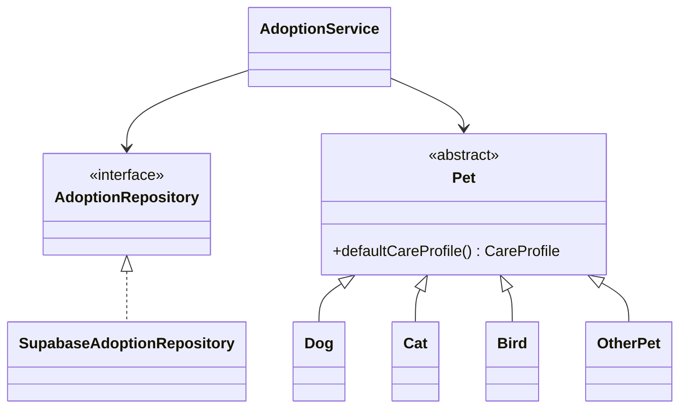

# OOP design

The shared Java core is the academic and production model. UI classes are adapters. Business rules live in constructors, validators, and services.

## Encapsulation

`User`, `Pet`, `AdoptionApplication`, `AuthSession`, and the other entities keep fields private. There are no setters. A change such as `withStatus` or `withProfile` returns a new instance, so a caller cannot mutate a stored application. `AuthSession.toString` omits tokens. `SupabaseConfig` does not expose a secret in its string form, and it refuses to be constructed from a service-role key.

Invalid pets cannot be constructed: name, city, description, age, and the published-photo rule are checked in the `Pet` constructor. Validators used by services repeat the checks that happen before a network call.

## Inheritance

`Pet` is abstract. `Dog`, `Cat`, `Bird`, and `OtherPet` extend it. The subclasses exist because the live schema allows four species, not only cats and dogs. `Bird` and `OtherPet` keep those rows representable. Each subclass passes its species to the protected constructor, so a `Dog` cannot be labeled as a cat.

## Polymorphism

`Pet.defaultCareProfile()` is abstract. Callers, including `PetService`, hold a `Pet` reference. `Dog` reports outdoor time. `Cat` reports litter care. The factory selects the class from `PetSpecies`, which is the value stored in `adoption_listings.species`.

Repository interfaces are the other polymorphic boundary. `AuthService` depends on `AuthRepository`. Tests supply Mockito doubles. The desktop and Android apps supply `SupabaseAuthRepository`. The service does not know which one it has.

## Abstraction

`AuthRepository`, `UserRepository`, `PetRepository`, `AdoptionRepository`, `MessageRepository`, and `NotificationRepository` are the ports. `TimeSource`, `MessageCatalog`, `SessionStore`, and `HttpTransport` are the other abstractions. `AdoptionRepository` has a Supabase implementation that fails closed, and the unit test uses an in-memory implementation that is not on the production classpath.

## SOLID

- Single responsibility: validators validate, services coordinate, repositories talk to HTTP, controllers render.
- Open/closed: a new species is a new `Pet` subclass plus a factory arm. Existing services stay unchanged.
- Liskov: every `Pet` subclass honors the same constructor invariants, including the published-photo rule.
- Interface segregation: message sending is not forced through the pet repository. Telegram is its own interface.
- Dependency inversion: `AdoptionService` receives `AdoptionRepository`, `PetValidator`, `RoleGuard`, and `TimeSource`. It does not construct OkHttp.

## Adoption rules in the service

`AdoptionService` rejects an application to the applicant's own listing, a listing that is not `PUBLISHED`, a second accept, a decision by someone who is not the owner, and a cancellation by someone who is not the applicant. Those rules are unit-tested. They are not a substitute for a database constraint.

## What the UI is allowed to know

`LoginFragment`, `HomeFragment`, `LoginController`, and `HomeController` translate error codes through the catalog or Android string resources. They do not decide whether an application can be accepted. The desktop admin button calls `RoleGuard` even though it is hidden for a non-admin.
